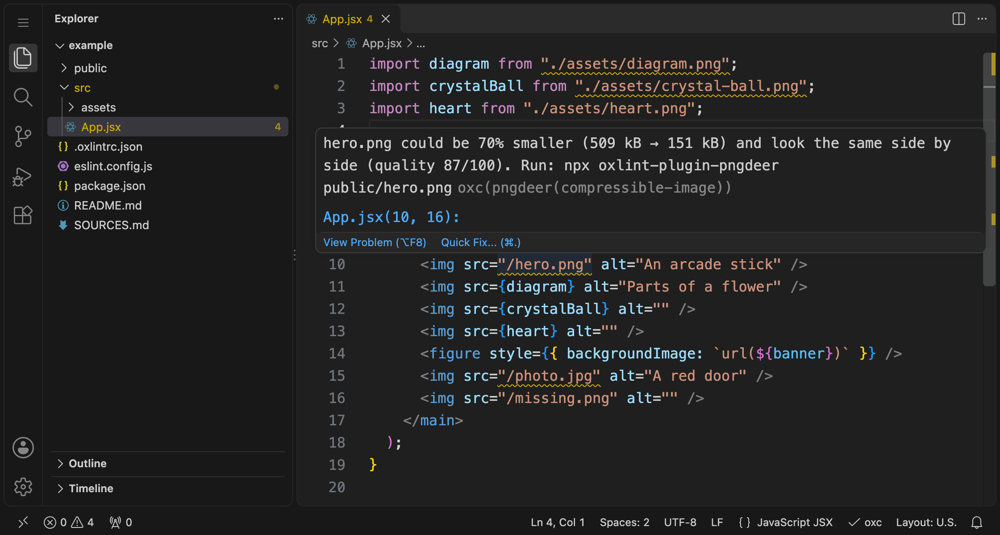
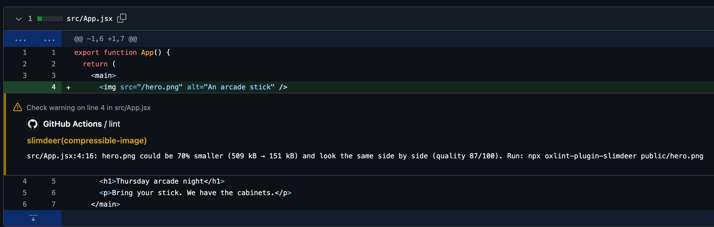
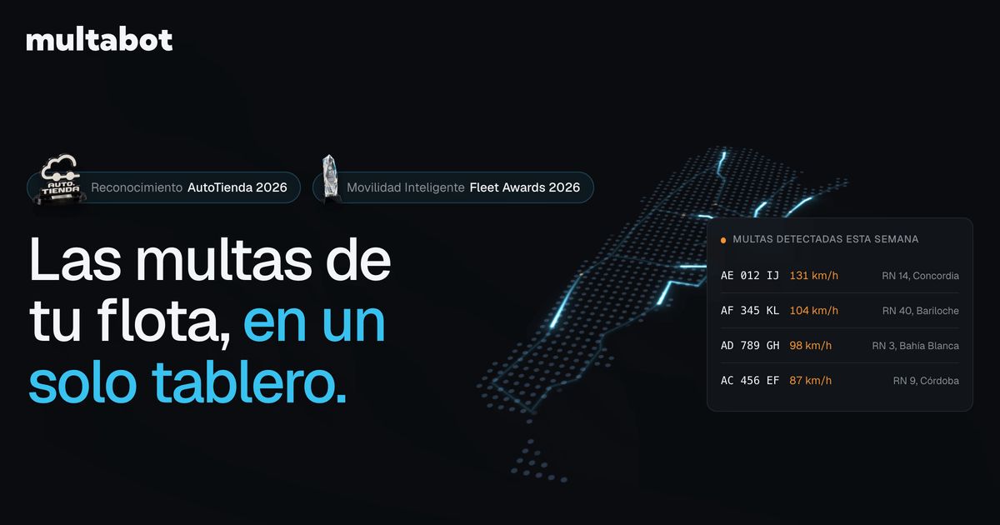

<p align="center">
  
</p>

<h1 align="center">oxlint-plugin-pngdeer</h1>

<p align="center"><strong>Catch heavy PNGs and JPEGs on the line of code that uses them.</strong></p>

<p align="center">
  <a href="https://www.npmjs.com/package/oxlint-plugin-pngdeer"></a>
  <a href="https://github.com/lndgalante/oxlint-plugin-pngdeer/actions/workflows/ci.yml"></a>
</p>

A lint rule for [oxlint](https://oxc.rs/docs/guide/usage/linter) and ESLint. It compresses the images your code uses with [pngdeer](https://github.com/heydeer/pngdeer), locally, and warns when one could be much smaller at about the same visual quality:

```
  ⚠ pngdeer(compressible-image): hero.png could be 70% smaller (509 kB → 151 kB) and look the same side by side (quality 87/100). Run: npx oxlint-plugin-pngdeer public/hero.png
    ╭─[src/App.jsx:10:16]
 10 │       
    ·                ───────────
    ╰────
```



Compressing your images once fixes today's. The rule also catches next month's 2 MB screenshot, in your editor and in the pull request that adds it.

## Try it on your images

From your project's folder, the one with `package.json`:

```bash
npx oxlint-plugin-pngdeer --check
```

It changes no files. It lists the PNGs and JPEGs that could be at least 4.1 kB and 10% smaller, including images used only from CSS or HTML, and ends with the commands that preview the biggest saving as a new file and shrink the biggest ones (up to 10) in place. It needs no linter setup, and caches its results for later lints. [Options and exit codes](https://github.com/lndgalante/oxlint-plugin-pngdeer/blob/main/docs/rules/compressible-image.md#check-images-without-changing-them)

Automatic, lossy compression of the example app's crystal-ball image saved **24,296 bytes (68.5%)**:

| Original · 35,475 bytes | Compressed · 11,179 bytes |
|---|---|
|  |  |

The gradients gained some texture. Compare previews at full size before replacing your own images.

Savings vary by image. On pinned copies of three public projects' images, `--check` flagged all 19 of the Vue docs' guide images (74% smaller in all, 1.2 MB → 316 kB) and 4 of the Docusaurus starter's 5 (53% smaller in all), but only 2 of Starlight's 12 small portraits (7% smaller in all). These are repository bytes: an image pipeline or CDN may already re-encode what users download. [The trials](https://github.com/lndgalante/oxlint-plugin-pngdeer/blob/main/bench/TRIALS.md)

On Multabot's live site, which serves images as they are, three images shipped 67% smaller in all. [The showcase](https://github.com/lndgalante/oxlint-plugin-pngdeer#showcase)

## Why a lint rule

Vite copies `public/` to the build as is, and compresses imported images only with a plugin. The usual fixes run at other moments:

- **Build plugins** like vite-plugin-image-optimizer re-encode during the build. The committed file stays heavy.
- **calibreapp/image-actions** commits recompressed images to the pull request's branch, so it needs write access, and it doesn't work on pull requests from forks without extra setup. **Imgbot** opens its own pull requests, lossless by default.
- **TinyPNG and ImageOptim** work when someone remembers to run them. TinyPNG uploads each image, and its API needs a key.
- **Lighthouse** reports heavy images on a page that is already running.

This rule shows the saving on the line that uses the image, with the command that applies it. It never changes an image by itself.

## Quick start with oxlint

Needs Node 20.19+ or 22.12+ and oxlint 1.60+. oxlint's JS plugins are alpha, so pin oxlint's version:

```bash
npm install --save-dev --save-exact oxlint
npm install --save-dev oxlint-plugin-pngdeer
```

Create `.oxlintrc.json` next to `package.json`, or edit the one you have (Vite's React templates and `npx oxlint --init` create one). The package goes in `jsPlugins`, not `plugins`. If the file has `rules`, add the rule there: a second `rules` key silently replaces the first.

```json
{
  "jsPlugins": ["oxlint-plugin-pngdeer"],
  "rules": { "pngdeer/compressible-image": "warn" }
}
```

Then run `npx oxlint`. It warns on each heavy image, then sums them up.

## Quick start with ESLint

If your project already lints with ESLint 9 or 10, ESLint runs the same rule and shares oxlint's cache. Needs Node 20.19+ or 22.12+ (22.13+ for ESLint 10).

```bash
npm install --save-dev oxlint-plugin-pngdeer
```

Add the recommended config. It turns the rule on for the files the rest of your config lints:

```js
// eslint.config.js
import pngdeer from "oxlint-plugin-pngdeer";

export default [
  // ...your config, which parses your JSX or TypeScript
  pngdeer.configs.recommended,
];
```

If your config doesn't lint and parse your JSX or TypeScript files yet, [add a config object for them](https://github.com/lndgalante/oxlint-plugin-pngdeer/blob/main/docs/rules/compressible-image.md#eslint-setup).

Then run `npx eslint .`, without `--cache`: ESLint would replay old warnings for images you already shrank, and pngdeer would print no summary.

## Quick start with Vite+

Vite+ brings its own oxlint, so install only the plugin:

```bash
npm install --save-dev oxlint-plugin-pngdeer
```

`vp lint`, and editors that start `vp lint --lsp`, read the `lint` block of `vite.config.ts`, not `.oxlintrc.json`:

```ts
// vite.config.ts
import { defineConfig } from "vite-plus";

export default defineConfig({
  // ...your config
  lint: {
    jsPlugins: ["oxlint-plugin-pngdeer"],
    rules: { "pngdeer/compressible-image": "warn" },
  },
});
```

Then run `npx vp lint`. Vite+ 1.4 brings oxlint 1.89, above the 1.60 the plugin needs.

## Shrink the images

Each warning ends with the command that shrinks its image. pngdeer is lossy, so preview first, and commit before you shrink in place:

```bash
# write one image's smaller version as a new file, to compare with the original
npx oxlint-plugin-pngdeer public/hero.png -o hero.preview.png
# shrink everything the last lint flagged, in place
npx oxlint-plugin-pngdeer --flagged
```

The command marks what it writes, so the rule doesn't flag it again. Each lossy pass costs quality, so shrink each image once. An image another tool already compressed can still be flagged: compare it by eye before you shrink it.

## Editors

Warnings show in editors that run your project's oxlint as a language server: the [Oxc extension](https://github.com/oxc-project/oxc-vscode) for VS Code and its forks, Zed's Oxc extension (when `package.json` lists `oxlint` or `vite-plus`), and Neovim's `oxlint` config. With ESLint, ESLint's own editor extensions run the rule.

The editor never waits for pngdeer, which measures images in the background. A file shows its warnings the next time the editor lints it, usually when you type in it. Lint once from the command line first, or commit the cache (see CI below), and the warnings are there when you open a file.

## CI

Lint each pull request, with annotations on the lines that name heavy images:

```yaml
# .github/workflows/images.yml
name: Images
on: pull_request
permissions:
  contents: read
jobs:
  lint:
    runs-on: ubuntu-latest
    steps:
      - uses: actions/checkout@v7
      - uses: actions/setup-node@v7
        with:
          node-version: 24
      - run: npm ci
      - run: npx oxlint --format github
```

A pull request that adds a heavy image then gets a warning on the line that uses it ([see it live](https://github.com/lndgalante/pngdeer-demo/pull/1/files)):



With ESLint, run `npx eslint .`: `actions/setup-node` turns its output into annotations. With Vite+, run `npx vp lint --format github`. GitHub annotates at most 10 warnings and 10 errors per step, your other lint warnings included; pngdeer's summary in the job log has the total.

Without a cache, CI measures every image on every run, one at a time on a 2-core runner (GitHub's default for private repositories). Commit the cache instead. In `.oxlintrc.json`, set the cache folder in `settings`, next to `rules`; in ESLint, in a config object; with Vite+, in the `lint` block of `vite.config.ts`:

```json
"settings": { "pngdeer": { "cacheDir": ".pngdeer" } }
```

Then fill the folder and commit it. This copies what your machine has already measured and measures the rest:

```bash
npx oxlint-plugin-pngdeer --check --cache-dir .pngdeer
```

If the rule sets a `target`, pass the same `--target`. In a monorepo, name each package's folder. Run it again after adding or changing images, and commit the folder. To clear old entries, or to cache in GitHub Actions instead, see [the cache](https://github.com/lndgalante/oxlint-plugin-pngdeer/blob/main/docs/rules/compressible-image.md#the-cache).

### Block only new heavy images

Set the rule to `"error"` to fail the check. To let through the heavy images you already have, list them in the rule's `exclude` option. They are no longer measured or reported, and `--flagged` leaves them alone.

With ESLint 9.24+ and the rule at `"error"`, you can suppress them instead: run `npx eslint --suppress-rule pngdeer/compressible-image` once and commit `eslint-suppressions.json`. pngdeer's summary and `--flagged` still include suppressed images, so shrink a new image with the command in its warning. After shrinking a suppressed one, run `npx eslint --prune-suppressions`.

## How it works

- **Local.** pngdeer, a lossy compressor like TinyPNG, ships in the package as 2 MB of WebAssembly: no upload, no API key, no dependencies, no native binaries, no install scripts.
- **About TinyPNG's quality.** By default, pngdeer keeps the smallest file that scores about what TinyPNG would give the image on [SSIMULACRA2](https://github.com/cloudinary/ssimulacra2), a 0–100 score of how close an image looks to its original (90 looks identical). In pngdeer's own benchmark of 180 PNGs, the median file is 8–12% smaller than TinyPNG's at the same quality ([leaderboard](https://github.com/heydeer/pngdeer#leaderboard)). For photos and screenshots with small text, try `"target": 90` and compare.
- **Slow once, then cached.** By default, the first lint compresses every PNG and JPEG in the project, in memory, with up to eight workers. Later lints read the cache. On a 16-core M3 Max, the first lint of an app with 39 images (12 MB) took 14.6 s and peaked at 3.0 GB of memory. Later lints took 178 ms, against 68 ms without the plugin (version 0.3.0; the engine hasn't changed since). [The benchmark](https://github.com/lndgalante/oxlint-plugin-pngdeer/blob/main/bench/README.md)
- **It reads** imports, `require`, `new URL(…, import.meta.url)`, JSX `src` and `srcSet`, and strings that start with `./`, `../`, `/` or an alias like `@/`, in JS and TS, and in the script parts of Vue, Svelte and Astro files. Images used only from CSS, HTML, Markdown or a Vue, Svelte or Astro template get no warning, but the summary lists them and `--check` reports them.

## Options

Pass options after the severity. These are the defaults:

```json
"pngdeer/compressible-image": ["warn", {
  "minSavedBytes": 4096,
  "minSavedPercent": 10,
  "target": "auto",
  "exclude": [],
  "scan": "project"
}]
```

- `minSavedBytes` and `minSavedPercent` set the smallest saving worth a warning. An image must clear both.
- `target` is the quality to keep: `"auto"`, or a SSIMULACRA2 score, where 90 looks identical and 80 the same side by side.
- `exclude` leaves out paths or patterns, relative to the project's folder, like `"public/originals"` or `"**/fixtures/**"`.
- `"scan": "referenced"` measures only the images the linted files name, for linting a few files. [Compare it with the default](https://github.com/lndgalante/oxlint-plugin-pngdeer/blob/main/bench/README.md#comparing-scan-scopes).

With ESLint's recommended config, set the rule again in a config object after it. [All options](https://github.com/lndgalante/oxlint-plugin-pngdeer/blob/main/docs/rules/compressible-image.md#options)

## Limits

- **Less useful behind `next/image`, Astro's `<Image>` or an image CDN,** which re-encode images for users anyway. Shrinking those mostly saves repository and build size, and adds a second lossy pass, so leave their folders out with `exclude`. Images served as they are, like plain `` and CSS backgrounds, still count. [When not to use it](https://github.com/lndgalante/oxlint-plugin-pngdeer/blob/main/docs/rules/compressible-image.md#when-not-to-use-it)
- **oxlint runs JS plugins only on 64-bit little-endian machines.** On some memory-constrained Linux machines, any JS plugin can make oxlint run out of memory ([oxc#20331](https://github.com/oxc-project/oxc/issues/20331)).
- **Some images get no warning.** pngdeer fails on some, like flat-color JPEGs, and the rule skips others, like grayscale PNGs with a color profile. A command-line lint names them on stderr. [What it skips](https://github.com/lndgalante/oxlint-plugin-pngdeer/blob/main/docs/rules/compressible-image.md#what-it-skips)

## Learn more

- [The rule's docs](https://github.com/lndgalante/oxlint-plugin-pngdeer/blob/main/docs/rules/compressible-image.md): what it flags, the `--check` command, every option and setting, paths and aliases, the cache, and turning it off.
- [CHANGELOG.md](https://github.com/lndgalante/oxlint-plugin-pngdeer/blob/main/CHANGELOG.md) lists the changes in each version, and [FINDINGS.md](https://github.com/lndgalante/oxlint-plugin-pngdeer/blob/main/FINDINGS.md) has the design notes.
- [CONTRIBUTING.md](https://github.com/lndgalante/oxlint-plugin-pngdeer/blob/main/CONTRIBUTING.md) has the development commands, what CI tests, and how releases work.

## Showcase

[Multabot](https://multabot.com.ar) tracks traffic fines in Argentina. It ran pngdeer's command line on three images that its Astro site, on Cloudflare Pages, serves from `public/` as they are. At `--target 90`, the quality suggested above for photos and screenshots with small text, they became 67% smaller in all (965 kB → 317 kB). Multabot shipped the compressed files: on November 2, 2026, the site served each one byte for byte. Two are below. The third, an annotated screenshot of a partner's site, went from 485,329 to 190,091 bytes (61% smaller). [The full report](https://github.com/lndgalante/oxlint-plugin-pngdeer/blob/main/docs/showcase.md#multabot)

| Original | Compressed at quality 90 |
|---|---|
| <br>Social preview · 370,801 bytes | <br>66,520 bytes · 82% smaller |
| <br>Blog photo · 108,899 bytes | <br>60,161 bytes · 45% smaller |

Using pngdeer in a real project? We'd like to feature more. [Share yours in an issue](https://github.com/lndgalante/oxlint-plugin-pngdeer/issues/new?template=showcase.yml): what it caught, how much smaller the images became, and whether the result looked good enough to ship. [A prompt](https://github.com/lndgalante/oxlint-plugin-pngdeer/blob/main/docs/showcase.md#a-prompt-to-share) helps a coding assistant draft one.

## License

[MIT](https://github.com/lndgalante/oxlint-plugin-pngdeer/blob/main/LICENSE). The engine's dependencies keep their own licenses ([engine/THIRD_PARTY_LICENSES.txt](https://github.com/lndgalante/oxlint-plugin-pngdeer/blob/main/engine/THIRD_PARTY_LICENSES.txt)), and [engine/README.md](https://github.com/lndgalante/oxlint-plugin-pngdeer/blob/main/engine/README.md) says where the engine comes from. The example images keep theirs ([example/SOURCES.md](https://github.com/lndgalante/oxlint-plugin-pngdeer/blob/main/example/SOURCES.md)), and the MIT license doesn't cover the showcase images. JPEG output is encoded with mozjpeg: this software is based in part on the work of the Independent JPEG Group.
